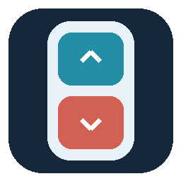

# OSAZEE BILRESA

**Author: OSAZEE · Public beta 0.1.0b1 · MIT license**

Make your **IKEA BILRESA dual-button Matter remotes** do more in Home Assistant: **dimming, single, double and triple clicks, dual-button clicks and holds**, with freely configurable actions for every gesture. Use one remote or give several remotes the same controls through a shared blueprint.

## Features

- **Single, double and triple clicks:** assign different action sequences to each button and click type.
- **Dual-button clicks:** press both buttons together for combined short-press, hold and triple-click gestures.
- **Dimming or custom holds:** hold Button 1 to brighten and Button 2 to dim a selected light, or use both holds for your own actions instead.
- **Multiple remotes, shared controls:** add more remotes to one automation so they all use the same action assignments.
- **Multiple actions per gesture:** control lights, plugs, covers, scenes and scripts, or combine several Home Assistant actions in order.
- **Adjustable recognition window:** fine-tune the default 250 ms cooldown to balance response speed and combined-press detection.
- **Optional rapid triple-click bridge:** the companion integration exposes the Matter signal needed for fast triple-click actions on BILRESA firmware 1.9.15.

**Triple-click limitation:** on firmware 1.9.15, the bridge recognizes **three or more quick clicks**, not exactly three. Rapid triple clicks require the companion integration and remain an experimental beta feature.

This is an independent community project, not an official IKEA or Home Assistant integration.

## Install

[](https://my.home-assistant.io/redirect/blueprint_import/?blueprint_url=https%3A%2F%2Fgithub.com%2Fodggg%2Fosazee-bilresa%2Fblob%2Fmain%2Fblueprints%2Fautomation%2FOSAZEE%2Fikea_bilresa_dual_button.yaml)

[](https://my.home-assistant.io/redirect/hacs_repository/?owner=odggg&repository=osazee-bilresa&category=integration)

**These install two different things.** Importing the blueprint does not install the companion integration. HACS installs the integration, not the blueprint.

- **Normal clicks, combined presses and holds:** import the blueprint; the companion is optional.
- **Rapid triple clicks on firmware 1.9.15:** install and configure the companion too, then enable **Raw triple-click bridge** in your automation.

### Requirements

- Home Assistant Core **2026.8.0 or newer**. Other versions are not yet verified.
- BILRESA **dual-button**, paired through Home Assistant's **Matter** integration.
- Two enabled native `event.*` button entities for every remote.
- HACS is optional; manual integration installation is supported.
- The scroll-wheel BILRESA, ZHA and Zigbee2MQTT are **not supported by the companion**.

### 1. Install the companion (for rapid triple clicks)

In HACS, use the button above or add `https://github.com/odggg/osazee-bilresa` as a **Custom repository**, category **Integration**. Download **OSAZEE BILRESA**, restart Home Assistant, then go to **Settings → Devices & services → Add integration → OSAZEE BILRESA**.

No host, credentials or device pairing are required. The companion uses the existing Matter client and discovers eligible native button entities.

**Manual alternative:** copy only `custom_components/osazee_bilresa/` from this repository into your Home Assistant `config/custom_components/` directory, restart, and add the integration as above. Do not copy your whole Home Assistant configuration into this repository.

This repository is not listed in the default HACS catalog. During beta, use the custom-repository method.

### 2. Import the blueprint

Click **Import blueprint** above, or open **Settings → Automations & scenes → Blueprints → Import blueprint** and paste:

```text
https://github.com/odggg/osazee-bilresa/blob/main/blueprints/automation/OSAZEE/ikea_bilresa_dual_button.yaml
```

Create an automation from the blueprint. The default entry is **Remote 1**: edit it and choose its **Button 1** and **Button 2** event entities. Use **Add** in the **Add remote** list for additional remotes.

All remotes in one automation share the same action assignments. Use a separate automation for a different set of assignments. Never select the same button entity twice; incomplete entries are ignored, and duplicate selections disable gesture handling until corrected.

### 3. Assign actions

Every gesture accepts a list of actions. Use Home Assistant's **Add action** control to run several actions in order; an empty list does nothing.

| Gesture | Configurable actions |
| --- | --- |
| Button 1 / Button 2 | Single click, double click, triple click, hold |
| Both buttons on the same remote | Short press, hold, triple click |

**Single-button hold behavior:**

- **Custom actions:** both hold action lists are available; no controlled light is required.
- **Light dimming:** select one light in the optional dimming section. Button 1 brightens and Button 2 dims. The two custom single-button hold lists remain visible but are ignored. Combined holds and all click actions remain configurable.

The **Recognition window / cooldown** defaults to **250 ms** and can be adjusted from **100–1500 ms**. It measures the gap between related events as received by Home Assistant, not the remote's internal click-counting timeout. Lower values respond faster but make combined presses harder to recognize. The remote may add its own delay before reporting a completed gesture.

Enable **Raw triple-click bridge** only after configuring the companion.

## Important: triple means at least three

BILRESA firmware **1.9.15** advertises `MultiPressMax=2`. Three or more quick clicks can produce `MultiPressComplete` with `totalNumberOfPressesCounted=0`; the native Matter event entity does not expose that completion.

The companion converts this **aborted multipress** into a live event for the blueprint. This means:

- Three quick clicks can run the triple-click action.
- **Four or more quick clicks may run the same action. Exact-three detection is not available with this firmware.**
- Both-button triple detection needs matching completions from the **same remote** within the configured window.
- Native `multi_press_3` is also handled when an integration provides it.
- The legacy double-then-single fallback depends on events supplied by the integration; it is not a promise that slow or spaced clicks will count as a triple.

The companion requires a fresh initial-press sequence, ongoing count 2, short release and aborted completion within three seconds. Historical diagnostics establish event-number floors only and are never fired as gestures. Pending recognition is cleared on reload/reconnect; repeated event numbers are ignored. Events received during Home Assistant startup do not emit gestures.

## Behavior and limitations

- A recognized combined gesture selects the combined action instead of both individual actions.
- The automation uses **single** mode: new gestures are ignored while the current action sequence is running, including a hold-to-dim run. Keep action lists short if fast response matters.
- Combination matching never joins buttons from two different remotes.
- Existing automations listening to these remotes can still collide. Move their assignments here or disable overlapping automations yourself.
- The blueprint ships with **no assigned lights, plugs, covers or personal entity IDs**.
- Cover movement/stop and scheduled brightness resets are **not built-in defaults**. Configure cover actions in the relevant action lists; daily schedules belong in separate automations. See [examples](docs/examples.md).
- This beta relies on internal interfaces of the Core Matter integration. Back up before updating Home Assistant; compatibility with future Core/device firmware versions is not guaranteed.

## Updating

**Integration:** update through HACS and restart when requested.

**Blueprint:** use **Re-import blueprint** in Home Assistant. Updates are not automatically downloaded with integration updates. Keep input keys stable so existing assignments continue to work.

Several remotes in the same automation always share its assignments. Separate automations share blueprint logic after the locally installed blueprint is updated/reloaded, but retain their own assignments.

## Troubleshooting

1. Confirm both native button event entities are enabled and change on a normal click.
2. Confirm **OSAZEE BILRESA** is loaded and **Raw triple-click bridge** is enabled in the blueprint automation.
3. Download the companion's diagnostics. `emitted_since_setup` increases for recognized raw gestures; `last_event` identifies the source button.
4. Check the automation trace and that the target entities are available.
5. Try one triple, then pause before retrying. Because actions may toggle, two successful tests can cancel each other visually.

Diagnostics contain entity/config-entry identifiers, not Matter credentials. Review/redact them before posting publicly. Report bugs at [GitHub Issues](https://github.com/odggg/osazee-bilresa/issues) with Core version, remote model/firmware, gesture and whether the raw counter increased.

## Testing and beta status

The raw triple signal and actual light toggling have been observed on a physical dual-button remote. This is not a complete hardware certification for every gesture, every remote or all firmware versions.

The automated tests cover detector sequences, duplicates, diagnostic replay, startup rejection, stale/missing events and remote/endpoint isolation. See [development and release checklist](docs/development.md). Combined gestures, dimming and reload/reconnect behavior still need broader physical beta testing.

## License

[MIT](LICENSE), copyright © 2026 **OSAZEE**.
